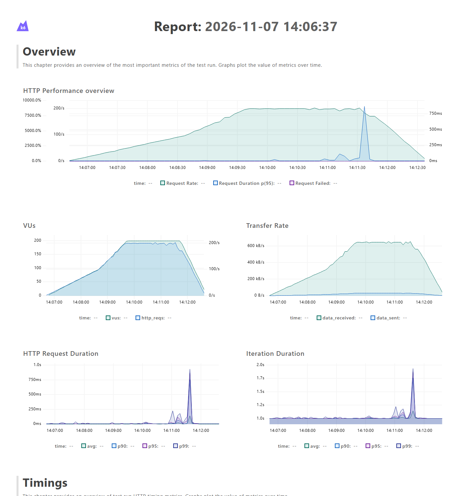
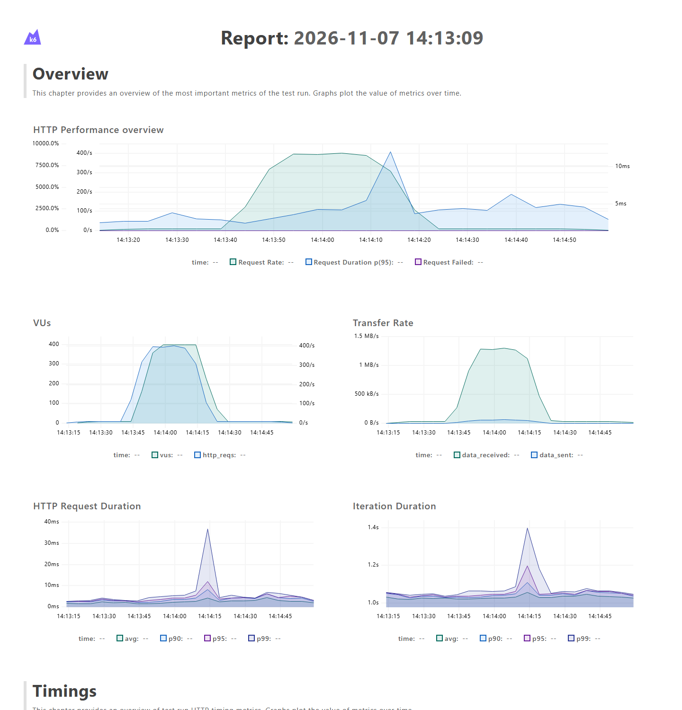

# Plano de teste de performance — Hub de Leitura

Exercício final de K6 utilizando Stress Test e Spike Test para validar a listagem de livros.

A cada iteração, o usuário consulta os livros e aguarda 1 segundo. A URL da aplicação vem de `config.js`.

Método escolhido para a pesquisa: **GET**.

```text
/api/books?category=Fantasia&available=true&limit=20&offset=0&orderBy=title&order=ASC
```


## Pré-requisitos

- K6 instalado e disponível no terminal.
- Hub de Leitura em execução, com banco configurado.
- Pelo menos um livro disponível na categoria Fantasia.
- Executar os comandos no PowerShell, na raiz deste projeto.

A URL padrão é `http://localhost:3000`. Para usar outra porta:

```powershell
$env:BASE_URL = "http://127.0.0.1:3001"
```

## Estrutura do projeto

```text
hub-de-leitura-k6/
├── tests/
│   ├── stress-teste.js
│   └── spike-teste.js
├── resultados/
├── config.js
├── .gitignore
└── README.md
```

## Criação do report e monitoria

O dashboard do K6 permite acompanhar a execução e exportar o relatório HTML. Cada teste salva seu relatório na pasta `resultados`.

```powershell
$env:K6_WEB_DASHBOARD = "true"
$env:K6_WEB_DASHBOARD_OPEN = "true"
$env:K6_WEB_DASHBOARD_PORT = "5665"
$env:K6_WEB_DASHBOARD_PERIOD = "5s"
```


## Execução Stress Test (Teste de estresse)

- Validar o comportamento da aplicação com o aumento gradual da carga.
- Validar a pesquisa de livros disponíveis da categoria Fantasia.
- Observar erros e tempos de resposta até 200 usuários virtuais.

### Configuração do teste

- VUs: aumento gradual de 0 até 200 usuários.
- Tempo dos estágios: 6 minutos.
- Pausa de 1 segundo ao final de cada iteração.
- Estágios:
    - ramp-up de 0 até 50 usuários em 1 minuto.
    - ramp-up de 50 até 100 usuários em 1 minuto.
    - ramp-up de 100 até 200 usuários em 1 minuto.
    - fica em 200 usuários por 2 minutos.
    - ramp-down para 0 usuários em 1 minuto.

### Execução via terminal

```powershell
$env:K6_WEB_DASHBOARD = "true"
$env:K6_WEB_DASHBOARD_OPEN = "true"
$env:K6_WEB_DASHBOARD_PORT = "5665"
$env:K6_WEB_DASHBOARD_PERIOD = "5s"
$env:K6_WEB_DASHBOARD_EXPORT = "resultados/stress-relatorio.html"
k6 run --summary-export resultados/stress-resumo.json .\tests\stress-teste.js
```

## Execução Spike Test (Teste de pico)

- Validar a reação da aplicação a um aumento repentino de usuários.
- Validar a pesquisa de livros disponíveis da categoria Fantasia.
- Observar a recuperação após o pico de 400 usuários virtuais.

### Configuração do teste

- VUs: pico de 400 usuários, com retorno à carga inicial.
- Tempo dos estágios: 1 minuto e 50 segundos.
- Pausa de 1 segundo ao final de cada iteração.
- Estágios:
    - ramp-up de 0 até 10 usuários em 10 segundos.
    - fica em 10 usuários por 20 segundos.
    - ramp-up até 400 usuários em 10 segundos.
    - fica em 400 usuários por 20 segundos.
    - ramp-down para 10 usuários em 10 segundos.
    - fica em 10 usuários por 30 segundos para observar a recuperação.
    - ramp-down para 0 usuários em 10 segundos.

### Execução via terminal

```powershell
$env:K6_WEB_DASHBOARD = "true"
$env:K6_WEB_DASHBOARD_OPEN = "true"
$env:K6_WEB_DASHBOARD_PORT = "5665"
$env:K6_WEB_DASHBOARD_PERIOD = "5s"
$env:K6_WEB_DASHBOARD_EXPORT = "resultados/spike-relatorio.html"
k6 run --summary-export resultados/spike-resumo.json .\tests\spike-teste.js
```


## Validações e limites

- Pesquisa de livros com status 200 e uma lista em `books`.
- Lista contendo entre 1 e 20 livros.
- Livros da categoria Fantasia com exemplares disponíveis.
- Títulos em ordem crescente, conforme a ordenação da base utilizada.

| Métrica | Meta |
|---|---|
| `checks` | Pelo menos 99% das verificações aprovadas |
| `http_req_failed` | Menos de 1% de requisições com falha |
| `http_req_duration` | p(95) menor que 1000 ms |


Para conferir o fluxo rapidamente, sem executar a carga completa:

```powershell
k6 run --stage 3s:1 --stage 3s:0 .\tests\stress-teste.js
k6 run --stage 3s:1 --stage 3s:0 .\tests\spike-teste.js
```

## Resultados e prints

Execuções completas renovadas em **07/11/2026**, separadamente, utilizando apenas o GET de livros em `http://127.0.0.1:3001`. Ambos os testes terminaram com código 0 e todos os thresholds aprovados.

| Métrica | Stress | Spike |
|---|---:|---:|
| VUs máximos | 200 | 400 |
| Requisições | 44.678 | 12.857 |
| Duração HTTP média | 6,90 ms | 2,45 ms |
| Duração HTTP p(95) | 8,40 ms | 4,77 ms |
| Duração HTTP máxima | 963,37 ms | 77,54 ms |
| Requisições com falha | 0% | 0% |
| Checks aprovados | 268.068 de 268.068 | 77.142 de 77.142 |

### Stress Test



[Relatório HTML](resultados/stress-relatorio.html) · [Resumo JSON](resultados/stress-resumo.json) · [Saída do terminal](resultados/stress-terminal.txt)

### Spike Test



[Relatório HTML](resultados/spike-relatorio.html) · [Resumo JSON](resultados/spike-resumo.json) · [Saída do terminal](resultados/spike-terminal.txt)
